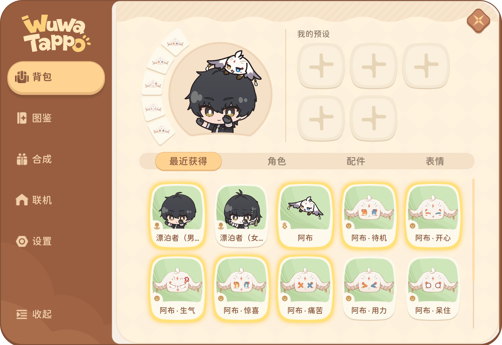

<div align="center">
  
  <h1>Wuwa Tappo · macOS</h1>
  <p>把鸣潮桌宠带到 Mac 桌面</p>
  <p><strong>1.0.5 全解锁离线版 · build 16</strong> · Apple Silicon · macOS 13+</p>
  <p><a href="https://github.com/lliooly/wuwa-tappo-mac/actions/workflows/check.yml?branch=dev%2Foffline-full-atlas">离线构建</a> · <a href="#使用说明">使用说明</a> · <a href="CHANGELOG.md">更新记录</a></p>
</div>

全解锁离线版提供素材快照中的 **899 项角色外观、配件和表情**。无需账号即可在本机换装、收藏和保存预设。此版沿用 1.0.5 的窗口、按钮、计数和 macOS 游戏模式适配，纳入菲比 · 经典的新版完整图及两张头部分层。

- **独立安装**。应用名为 `Wuwa Tappo Offline.app`，可与 [标准版](https://github.com/lliooly/wuwa-tappo-mac/tree/main)并存。
- **本地装扮**。保留角色专属配件与表情规则，最多装备 5 个表情，保存 10 个预设。
- **版本与下载**。离线版在 `dev/offline-full-atlas` 分支维护。打开 [GitHub Actions](https://github.com/lliooly/wuwa-tappo-mac/actions/workflows/check.yml?branch=dev%2Foffline-full-atlas)，在对应运行的 Artifacts 下载离线版 ZIP 和 SHA-256 校验文件。

<p align="center">
  
</p>

## 安装

需要 **Apple Silicon Mac 和 macOS 13 或更新版本**。

下载并解压 Actions 构建附件中的 `Wuwa-Tappo-mac-offline-full-atlas-arm64.zip`，把 `Wuwa Tappo Offline.app` 拖进「应用程序」。同一附件提供 SHA-256 文件。

安装包使用 ad-hoc 签名。若 macOS 拦截启动，先尝试打开一次，再到「系统设置 → 隐私与安全性」选择「仍要打开」。

## 使用说明

- **启动并计数**。在菜单栏桌宠图标中选择「授权输入监控…」，在「系统设置 → 隐私与安全性 → 输入监控」启用 Wuwa Tappo，回到应用选择「重试监听」。输入监控用于桌宠动作与点击计数。
- **本地装扮**。从背包选择角色、配件和表情，当前配置、收藏与预设均保存到离线版的独立本地存档。
- **跟随系统游戏模式**。在「设置 → 游戏模式设置」打开「跟随 macOS 游戏模式」。该功能默认关闭，需要 macOS 14 或更新版本。开启后，桌宠跟随系统状态，桌宠自身的全屏自动切换暂时停用。

## 从源码构建

需要 Xcode Command Line Tools、Python 3.9+ 和 Git。将应用和素材仓库放在同一个父目录。

```sh
git clone https://github.com/lliooly/wuwa-tappo-assets.git
git -C wuwa-tappo-assets checkout cbc59ee9fd257f15c1d1db5bebd74e673a21184a
git clone https://github.com/lliooly/wuwa-tappo-mac.git
cd wuwa-tappo-mac
git switch dev/offline-full-atlas
python3 scripts/build-macos.py --offline-full-atlas
open 'dist/Wuwa Tappo Offline.app'
```

构建会生成独立应用、离线 ZIP 和校验文件。使用 Node.js 22+ 运行 `python3 scripts/verify-offline.py` 校验离线包。构建和签名见[开发指南](docs/开发指南.md)，本地换装和重启恢复检查见[离线验收](docs/离线特别版验收.md)。参与项目见[贡献指南](CONTRIBUTING.md)。

## 致谢与许可

感谢 [Wuwa Tappo 国服](https://download-mc-wuwatappo.kurogames-global.com/download/) 的桌宠、角色美术及界面，感谢 [wuwa-tappo-assets](https://github.com/lliooly/wuwa-tappo-assets) 的素材整理与校验。

本项目是社区维护的非官方移植。原创适配代码和文档采用 [MIT](LICENSE)，原作素材、字体及商标保留各自权利。参见 [第三方说明](THIRD_PARTY_NOTICES.md) 和 [非官方声明](DISCLAIMER.md)。
